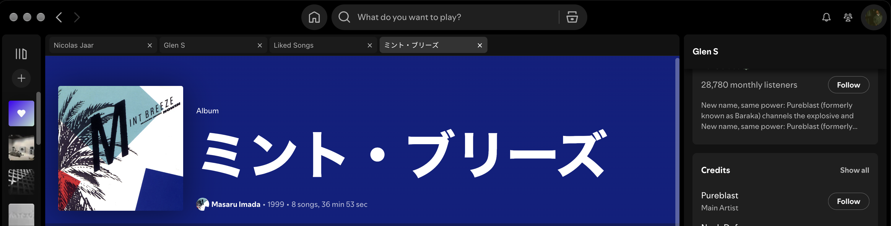

# Spotify Tabs

Tabs for the Spotify desktop app on macOS



## Run

Quit Spotify if it is already running normally, then:

```sh
npm ci
npm run build
npm start
```

## Controls

- **+** beside the last tab or **⌘T**: new tab.
- Click a tab or **⌘1–9**: switch tabs.
- Drag tabs to reorder; **×** closes a tab.
- With a tab focused, use **←/→**, **Home** or **End** to switch.
